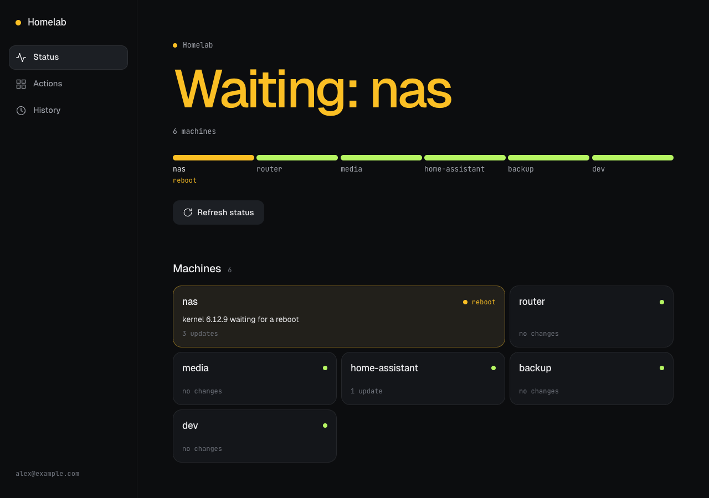
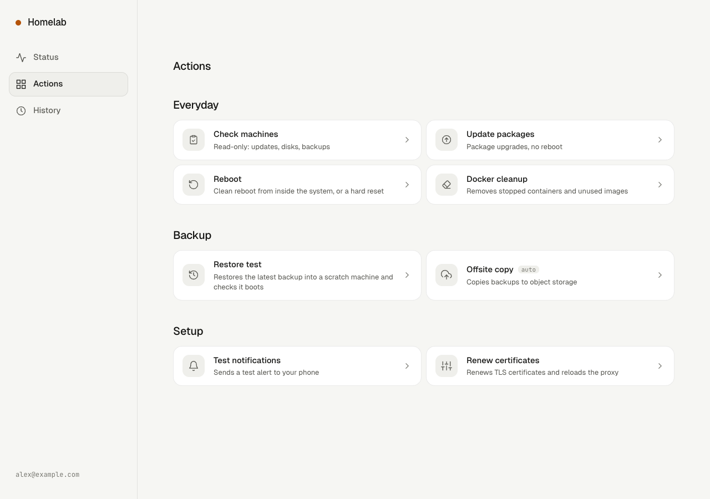
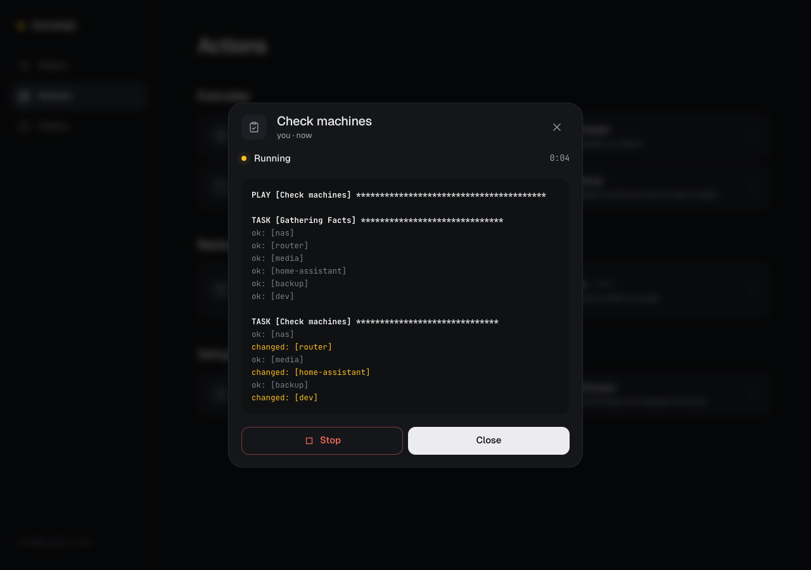
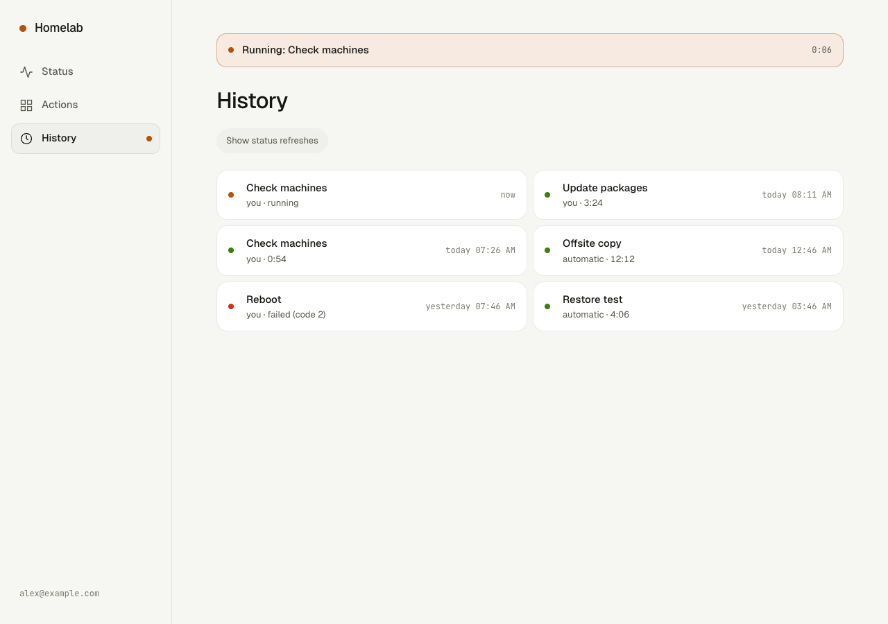
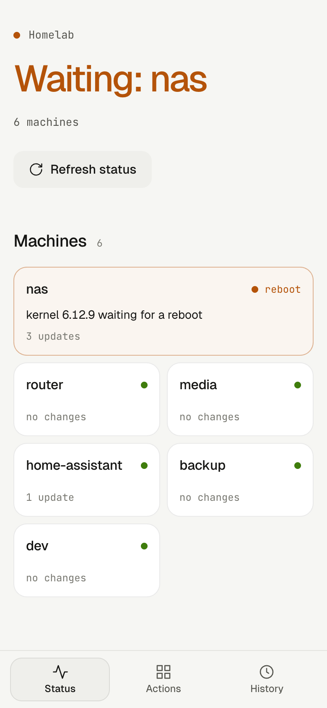

# Lamp

A calm, phone-friendly web UI for [OliveTin](https://www.olivetin.app/).

Point OliveTin's `webUIDir` at the `src` folder and your buttons become a small control room: actions grouped the way your dashboard groups them, a long press for anything that changes something, live output while it runs, and a history you can read on a phone. Add one JSON file and you also get a Status screen for your machines.



| | |
|---|---|
|  |  |
|  |  |

- **No build, no dependencies, no CDN.** Plain ES modules and CSS; fonts (Geist, JetBrains Mono, OFL) are bundled.
- **Nothing to configure to start.** Groups come from your dashboard's fieldsets, icons from your `mdi:*` icons, the language from the browser (English and Polish).
- **Same security as OliveTin.** Lamp only calls OliveTin's own API on the same origin, so your authentication and access control lists apply unchanged. It cannot do anything the signed-in user can't.
- **Hold to run.** Actions with a named `confirmation` argument need a 0.9 s press instead of a checkbox.
- **Live runs.** Output streams in with light highlighting (Ansible, shell), with Stop and Copy.
- **Light and dark**, following the system. A rail on desktop, a bottom bar on phones, sheets instead of popups.

## Install

```sh
git clone https://github.com/DabuSoft-pl/olivetin-lamp
sudo cp -r olivetin-lamp/src /etc/OliveTin/lamp
```

In OliveTin's `config.yaml`:

```yaml
webUIDir: /etc/OliveTin/lamp
```

Restart OliveTin. To go back, remove `webUIDir`.

OliveTin serves static files with `Last-Modified` but no `Cache-Control`, so a browser may keep the previous version for a while after an upgrade. File URLs carry the version (`app.js?v=1.0.0`) to limit that; if a phone still shows the old UI, reload it once.

Tested with OliveTin **3000.21**. Lamp uses OliveTin's API (`Init`, `WhoAmI`, `GetDashboard`, `GetLogs`, `StartAction`, `ExecutionStatus`, `KillAction`, `GetEntities`, `GetEntity`); OliveTin's maintainer considers these stable ([discussion #1163](https://github.com/OliveTin/OliveTin/discussions/1163)).

## Configure (optional): `lamp.json`

Put `lamp.json` next to `index.html`. Every key is optional; labels can be a string or `{"en": "...", "pl": "..."}`.

```json
{
  "title": "Homelab",
  "lang": "auto",
  "groups": ["Everyday", "Backup", "Setup"],
  "actions": {
    "update": { "description": "Package upgrades, no reboot", "icon": "update" },
    "notify": { "group": "Setup" },
    "debug":  { "hidden": true }
  }
}
```

| Key | What it does |
|---|---|
| `title` | Name in the sidebar and tab. Default: OliveTin's `pageTitle`. |
| `lang` | `auto` (browser), `en` or `pl`. |
| `dashboards` | Which OliveTin dashboards to read actions from. Default: all. |
| `groups` | Order of groups. Default: the order of fieldsets in the dashboard. |
| `actions.<id>` | Per action: `title`, `description`, `group`, `icon`, `hidden`. |
| `status` | Turns on the Status screen, see below. |

Icons: `activity clipboard update restart history cloud eraser package sliders tag database bell server terminal power download trash clock play`.

## Status screen

The Status screen shows one card per machine, a big headline with the worst state and a strip with one segment per machine. Tapping a machine opens a sheet with actions for just that machine.

It reads an OliveTin entity file you write from any script, see [`examples/machines.yaml`](examples/machines.yaml) for the fields. Then:

```json
{
  "status": {
    "entity": "machine",
    "refreshAction": "status",
    "details": [
      { "field": "updates", "label": "Updates" },
      { "field": "uptime", "label": "Uptime", "format": "days" }
    ],
    "machineActions": [
      { "action": "check",  "args": { "limit": "{name}" }, "title": "Check" },
      { "action": "reboot", "args": { "host": "{name}" },  "title": "Reboot", "only": { "field": "kind", "in": ["vm"] } }
    ]
  }
}
```

| Key | What it does |
|---|---|
| `entity` | Entity name in OliveTin's `entities:`. |
| `summary` | Optional entity with one instance (`state`, `headline`, `detail`) for the headline. Without it Lamp writes one. |
| `refreshAction` | Action id behind "Refresh status". Its runs are hidden from History unless switched on. |
| `details` | Fields listed in the machine sheet. `format: "days"` shows `41 d` / `5 h`. |
| `machineActions` | Actions offered in the machine sheet. `args` are preset (`{field}` is replaced with the machine's value) and shown as chips; `only` limits the action to machines whose field is one of `in`. |

A full OliveTin example with stable action ids, a named confirmation and the `system` access list that scheduled runs need is in [`examples/olivetin-config.yaml`](examples/olivetin-config.yaml).

## Develop

```sh
node dev/server.mjs                                        # mock API with demo data, http://127.0.0.1:8080
OLIVETIN_URL=http://olivetin.lan:1337 node dev/server.mjs  # your OliveTin behind the same origin
```

The mock implements the API calls Lamp makes, with runs that stream output and enforce named confirmations. The demo config is [`dev/demo-lamp.json`](dev/demo-lamp.json); set `LAMP_CONFIG=` to try Lamp without one.

Releasing: `dev/release.sh X.Y.Z ["notes"]` bumps the `?v=` versions in `src/`, tags, pushes and publishes `lamp-X.Y.Z.tar.gz` on GitHub; with `homelab-ansible` checked out next to this repo it also updates the version and sha256 there.

Translations live in [`src/i18n.js`](src/i18n.js); copy the `en` block to add a language.

## License

MIT. Fonts: Geist and JetBrains Mono, SIL Open Font License (`src/fonts/OFL-*.txt`).
